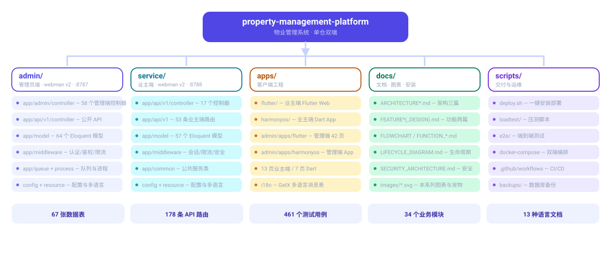
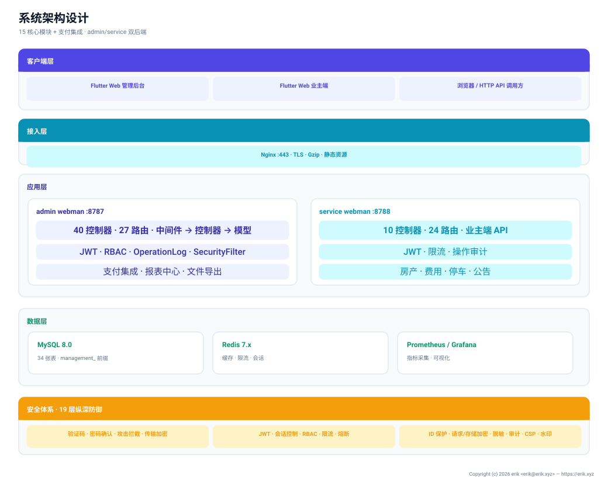
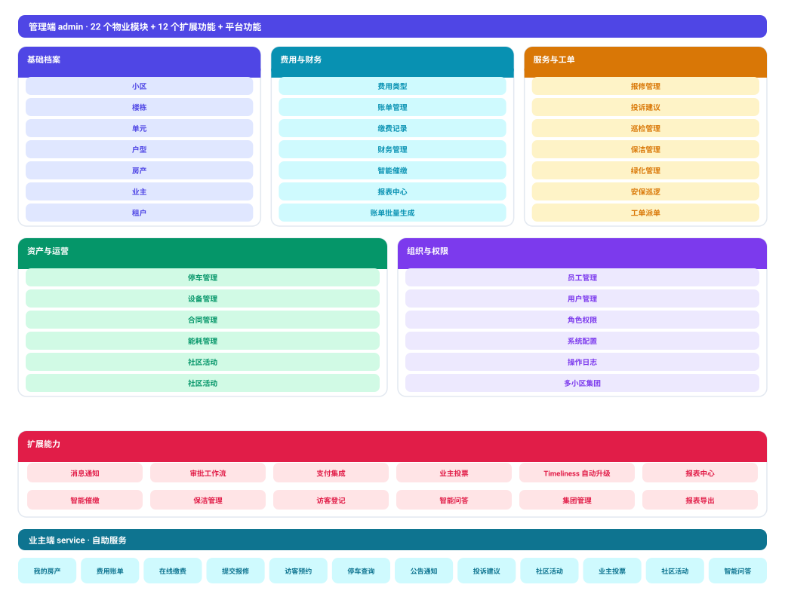
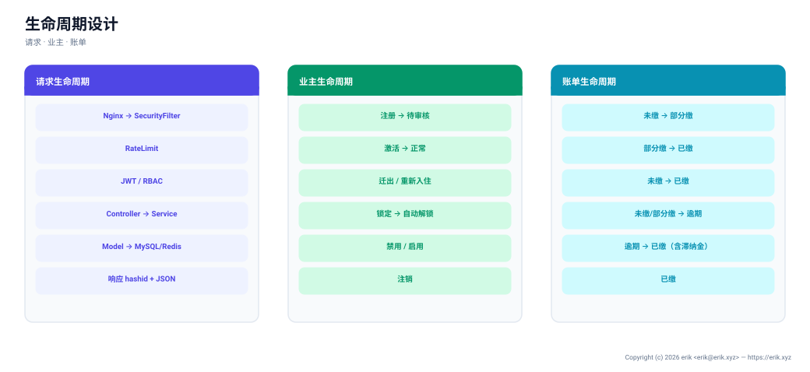

# 物业管理系统 (Property Management Platform)

[English](README_EN.md) | 中文

> Copyright (c) 2026 erik erik@erik.xyz — https://erik.xyz


全栈物业管理系统，覆盖15个业务模块 + 支付集成扩展功能。管理员端（admin）和业主端（service）分离部署，前端为 Flutter Web（PC 管理后台风格）。

**小筑** 是本项目的宠物 —— 一位楼宇管家：一栋亮着灯的公寓楼，戴管家帽、拿工单板，胸前工牌打勾。它出现在安装向导、错误页、登录页与架构图中，代表「在管的每一栋楼都有人照看」。

## 项目宠物 · 小筑


| 项 | 说明 |
|----|------|
| 形象 | 拟人化楼宇管家（亮窗代表在管房源，工单板代表物业服务闭环） |
| 配色 | 靛蓝 `#4F46E5` + 暖橙 `#F59E0B`，与前端主题一致 |
| 矢量文件 | [docs/images/pet_xiaozhu.svg](docs/images/pet_xiaozhu.svg)（中英文共用） |
| 图标标记 | [docs/images/favicon.svg](docs/images/favicon.svg)，已部署到 6 处（两端 Flutter 的 `assets/` 与 `web/`、`admin/public/`、`service/public/`）；全平台派生位图（应用图标 / 启动图 / favicon.ico 等）由 [scripts/gen-pet-icons.sh](scripts/gen-pet-icons.sh) 生成 |
| 已接入 | 安装向导 3 步 + 已安装页 · 404 / 504 错误页（内联矢量）· 业主端与管理端 Flutter 登录页 · 两端 Flutter 的壳层图标与启动图（launcher / 应用图标 / splash）· Flutter 空态插图 · 两个 Web 入口的浏览器标签图标 · 两个后端的多尺寸 favicon.ico · 架构图横切栏 |


## 项目宠物表情形态 · 小筑

| 表情 | 图片 | 代码 | 表情 | 图片 | 代码 |
|---|---|---|---|---|---|
| 笑 |  | `:emoji-smile:` | 欢乐 |  | `:emoji-joy:` |
| 哭 |  | `:emoji-cry:` | 沮丧 |  | `:emoji-depressed:` |
| 惊恐 |  | `:emoji-terrified:` | 愤怒 |  | `:emoji-angry:` |
| 撒娇 |  | `:emoji-coquettish:` | 卖萌 |  | `:emoji-cute:` |
| 讨好 |  | `:emoji-pleasing:` | 敲打 |  | `:emoji-knocking:` |
| 捂脸 |  | `:emoji-facepalm:` | 吐舌头 |  | `:emoji-tongue:` |

> 12 种彩色动态形态：笑 / 欢乐 / 哭 / 沮丧 / 惊恐 / 愤怒 / 撒娇 / 卖萌 / 讨好 / 敲打 / 捂脸 / 吐舌头。每个 SVG 自带表情、情绪特效与整体动效，并遵循 `prefers-reduced-motion`。
## 视觉资产授权 / Visual Assets License

本项目的项目宠物、图片、图标、表情（包括 `docs/pet-expressions/` 等目录下的
SVG / PNG）**不是开源资产**，版权归作者所有。未经书面许可不得复制、修改、再分发或
用于商业用途；商业使用需取得商业授权，联系 **erik@erik.xyz**。详见
[ASSETS-LICENSE.md](ASSETS-LICENSE.md)。

> 代码部分仍遵循仓库原有 `LICENSE`；第三方素材（如明确标注的 Go Gopher 等）仍遵循其原许可证。
## 项目结构

```
property-management-platform/
├── admin/                         # 管理员端 webman v2 项目
│   ├── app/
│   │   ├── admin/controller/      # 管理端控制器
│   │   ├── api/v1/controller/     # 公开 API 控制器
│   │   ├── common/                # 公共工具类
│   │   ├── middleware/            # 中间件（认证/鉴权/限流/安全）
│   │   ├── model/                 # 数据模型（Eloquent ORM）
│   │   ├── queue/                 # 队列任务
│   │   └── process/               # 进程管理
│   ├── apps/
│   │   └── flutter/               # 管理后台 Flutter Web（PC 风格）
│   ├── config/                    # 配置文件（含中文注释）
│   ├── database/
│   │   └── backup/                # 数据库备份脚本
│   ├── resource/
│   │   └── translations/          # 国际化语言文件（zh_CN / en）
│   ├── docs/                      # 管理端文档
│   ├── tests/                     # 单元测试
│   └── public/                    # Web 入口
├── service/                       # 业主业务端 webman v2 项目
│   ├── app/
│   │   ├── api/v1/controller/     # 业主端 API 控制器
│   │   ├── common/                # 公共工具类
│   │   ├── middleware/            # 中间件
│   │   ├── model/                 # 数据模型
│   │   └── process/               # 进程管理
│   ├── config/                    # 配置文件
│   ├── resource/
│   │   └── translations/          # 国际化语言文件
├── apps/
│   └── flutter/                   # 业主端 Flutter Web（PC 风格）
└── docs/                          # 项目文档
    ├── ARCHITECTURE.md
    ├── ARCHITECTURE_DESIGN.md
    ├── ARCHITECTURE_DIAGRAM.md    # 系统架构图
    ├── FLOWCHART.md               # 业务流程图
    ├── FUNCTION_DIAGRAM.md        # 功能模块图
    ├── LIFECYCLE_DIAGRAM.md       # 生命周期图
    ├── SECURITY_ARCHITECTURE.md   # 安全架构图
    ├── API.md
    ├── FEATURES.md
    └── FEATURE_DESIGN.md
```



## 项目规模

| 层 | 数量 | 详情 |
|----|------|------|
| 数据库表 | 34张 | 全部 `management_` 前缀，BIGINT 非自增主键 |
| PHP 模型 | admin 32 / service 25 | 均为 Eloquent 模型，含 encryptable 加密字段；service 端 25 为模型文件数（含 BaseModel 基类） |
| admin 控制器 | 40个 | 通用管理 + 15个物业模块 + 1个扩展功能 |
| service 控制器 | 10个 | 业主端全部 API |
| API 路由 | 51 | admin 27 + service 24 |
| Flutter 管理后台 | 26页 | admin 26个页面模块，67文件/5,532行 |
| Flutter 业主端 | 8页 | 首页/费用/停车/个人中心，17文件/1,942行 |
| 测试 | 76个 | 后端 65（admin 43 + service 22）+ Flutter 11（管理端 1 + 业主端 10）；随源码一同分发 |

## 系统架构与设计图

> 以下四张为手绘 SVG（中英双版，英文版 `*_en.svg`）；更细的 Mermaid 图表见 [架构图](docs/ARCHITECTURE_DIAGRAM.md) · [流程图](docs/FLOWCHART.md) · [功能图](docs/FUNCTION_DIAGRAM.md) · [生命周期图](docs/LIFECYCLE_DIAGRAM.md) · [安全架构图](docs/SECURITY_ARCHITECTURE.md)

### 架构设计



### 功能设计



### 生命周期



### 核心业务流程



### 19层安全纵深防御



## 功能模块（15大模块 + 1扩展）

| 批次 | 模块 | 状态 |
|------|------|------|
| 第1批 | 小区、楼栋、单元、户型、房产、业主、租户、费用、公告（9模块） | ✅ 全部完成 |
| 第2批 | 停车、设备（2模块）+ 面板可视化 + Excel/PDF导出（平台功能） | ✅ 全部完成 |
| 第3批 | 安保巡逻、保洁、绿化、员工（4模块） | ✅ 全部完成 |
| 扩展 | 支付集成（1模块：管理端支付订单/回调/退款） | ✅ 后端完成（业主端在线支付未接入） |
| 平台功能 | 报表中心（收缴率 / 缴费方式 / 欠费排行 / PDF导出）+ 业主起始页统计（我的房产 / 待缴费用 / 公告） | ✅ 全部完成 |

## 技术栈

### 后端
- **框架**: webman v2 (workerman/webman)
- **语言**: PHP 8.3+
- **数据库**: MySQL 8.0+，表前缀 `management_`，主键 BIGINT 非自增
- **缓存**: Redis 7.x

### 核心依赖
| 包名 | 用途 |
|------|------|
| `erikwang2013/snowflake-php` | 全局唯一 BIGINT 主键生成 |
| `erikwang2013/hashids` | API 层 ID 加解密 |
| `erikwang2013/jwt-webman` | JWT 认证（HS256） |
| `erikwang2013/encryption` | API 传输敏感数据 AES-256-CBC 加密 |
| `erikwang2013/encryptable` | 数据库敏感字段加解密 |
| `illuminate/database` | Eloquent ORM / 查询构造器 / 分页 |
| `erikwang2013/season` | 国家旗帜数据 |
| `erikwang2013/security-php` | 安全工具检测 |
| `erikwang2013/poster-php` | 敏感操作随机验证码 |
| `phpoffice/phpspreadsheet` | Excel 导出 |
| `barryvdh/laravel-dompdf` | PDF 导出 |
| `hg/apidoc` | API 接口文档自动生成 |

### 前端
- **Flutter 3.x** + GetX（含 i18n） + Dio + fl_chart + flutter_svg（宠物矢量图） — PC 风格 Web 管理后台与业主端

### API 文档

全部 API 端点与参数说明见独立文档 [docs/API.md](docs/API.md)。启动服务后也可访问 apidoc 自动生成的交互式文档：

| 端 | 地址 | 分组 |
|----|------|------|
| 管理端 | `http://localhost:8787/apidoc` | 10组（common/dashboard/system/property-core/property-aux/property-adv/extensions/export/import/upload） |
| 业主端 | `http://localhost:8788/apidoc` | 6组（公开接口/首页/费用/反馈/停车/个人） |

### 国际化

- **PHP 后端**: symfony/translation，语言文件位于 `resource/translations/{zh_CN,en}/messages.php`
- **Flutter Web**: GetX `Translations`，`apps/flutter/lib/i18n/messages.dart`
- **默认语言**: 简体中文（zh_CN），支持英语（en）切换
- **请求头**: 支持通过 `Accept-Language` 请求头控制响应语言

## 安全体系（19层纵深防御）

1. 点击验证码 → 2. 密码二次确认 → 3. poster 随机验证 → 4. security-php 安全扫描 → 5. SecurityFilter 攻击拦截 → 6. HTTPS + AES-256-CBC 传输加密 → 7. JWT HS256 认证 → 8. 并发会话限制(最多3个) → 9. 账号锁定(5次失败/15分钟) → 10. RBAC 权限鉴权(method.path 粒度) → 11. Redis 滑动窗口限流 → 12. Redis 熔断器(支付/回调快速失败+半开探测) → 13. Hashids ID 保护 → 14. 请求体敏感字段加密 → 15. DB 字段加密存储 → 16. 展示层数据脱敏 → 17. 操作日志全量审计(8平台来源端) → 18. CSP 头防护 → 19. PDF 版权水印

## 代码规范

- 所有新建文件头包含版权声明：`Copyright (c) 2026 erik erik@erik.xyz — https://erik.xyz`
- 全局函数/类引用使用 `use` 导入，不加前置 `\`
- 配置文件包含中文注释说明每个配置项
- 主键 ID 使用 BIGINT UNSIGNED NOT NULL，由 snowflake-php 应用层生成
- API 传输 ID 使用 hashids 加解密

## 快速开始

### 方式一：一键安装脚本（最快）

```bash
bash scripts/deploy.sh
# 自动完成：git pull → 生成双端 .env 与密钥 → Docker Compose 启动
# → 数据库初始化（幂等）→ 监控冒烟验证
# 管理端 http://localhost:8787 · 业务端 http://localhost:8788
```

> 要求：Docker + Docker Compose。脚本幂等，可重复执行；详见 [scripts/deploy.sh](scripts/deploy.sh)。

### 方式二：Docker Compose 部署

```bash
cd admin
cp .env.docker .env
php ../scripts/gen_env_keys.php --file=.env --replace-placeholders  # 自动生成全部密钥
docker compose up -d                                                # 首次启动自动导入建库 SQL
# 业务端: cd service 重复上述三步（端口已预设偏移，可与 admin 同主机共存）
```

> 密钥自动生成：模板中 `change-me*` 占位符会被替换为随机密钥；**已存在的密钥一律保留**，重复执行只追加缺失键。完整说明见下方 [Docker 部署](#docker-部署)。

### 方式三：Web 安装向导

启动管理端后访问 `http://localhost:8787/install`，通过界面完成数据库配置和后台管理员账户创建。

```bash
cd admin
cp .env.example .env
composer install
php start.php start -d
# 访问 http://localhost:8787/install 完成安装
```

详见 [安装指南](docs/INSTALL.md)。

### 方式四：手动安装

#### 环境要求

- PHP 8.1+
- MySQL 8.0+
- Redis 6.0+
- Composer 2.x
- Flutter SDK 3.x（前端开发）

#### 1. 初始化数据库

```bash
mysql -u root -e "CREATE DATABASE IF NOT EXISTS management DEFAULT CHARSET utf8mb4 COLLATE utf8mb4_unicode_ci;"
mysql -u root management < docs/install.sql
```

#### 2. 启动管理端

```bash
cd admin
cp .env.example .env
# 编辑 .env 修改数据库密码等配置
composer install
php start.php start -d
# 管理端运行在 http://localhost:8787
```

### 3. 启动业务端

```bash
cd service
cp .env.example .env
# 编辑 .env 修改数据库密码等配置
composer install
php start.php start -d
# 业务端运行在 http://localhost:8788
```

### 4. 启动前端（开发）

```bash
cd apps/flutter
flutter pub get
flutter run -d chrome
```

### 5. 运行测试

```bash
# 管理端测试
cd admin && php vendor/bin/phpunit

# 业务端测试
cd service && php vendor/bin/phpunit
```

| 项目 | 测试数 | 断言数 | 通过率 |
|------|--------|--------|--------|
| admin | 43 | 103 | 100% |
| service | 22 | 42 | 100% |
| **合计** | **65** | **145** | — |

后端单元测试覆盖: 支付纯函数/微信回调解密/账单状态与滞纳金/密码规则/Validator/分页；Flutter 测试 11 例。
历史全量测试快照见 [docs/tests/](docs/tests/)（admin-unit-report / service-unit-report / api-report / e2e-report / go-unit-report / rust-unit-report）。

### Docker 部署

每条堆栈（admin / service）各自独立编排：Nginx + PHP(webman) + MySQL + Redis + Prometheus + Grafana + redis-exporter。

```bash
# 一键（推荐，幂等）：密钥补齐 → 双端启动 → 建库校验 → 监控冒烟
bash scripts/deploy.sh

# 手工部署单端（以 admin 为例）
cd admin
cp .env.docker .env
php ../scripts/gen_env_keys.php --file=.env --replace-placeholders
docker compose up -d
```

**密钥口径**

- 模板内 `change-me*` 为占位符，由 `gen_env_keys.php` 生成随机值；`.env` 中已有的真实密钥绝不覆盖（旧密钥保留），缺失键只做追加
- 数据库加密密钥轮换用 `bash scripts/rotate_keys.sh`（旧 key 自动写入 `ENCRYPTION_PREVIOUS_KEYS`）
- MySQL 容器的库名/用户/密码默认派生自 `DB_DATABASE/DB_USERNAME/DB_PASSWORD`（单一真源），无需重复配置 `MYSQL_*`

**服务端口**（同主机双栈时已预设偏移；Nginx 需手动错开）

| 服务 | admin | service |
|------|-------|---------|
| 应用 | 8787 | 8788 |
| MySQL | 3306 | 3307 |
| Redis | 6379 | 6380 |
| Prometheus / Grafana | 9090 / 3000 | 9091 / 3001 |
| Nginx | 80 / 443 | 建议 8080 / 8443（`.env` 的 `NGINX_PORT`/`NGINX_SSL_PORT`） |

> 首次启动时 MySQL 数据卷为空，`docs/install.sql`（34 张表 + RBAC 种子）经 compose initdb 挂载自动导入；卷已有数据时不重复导入。
>
> ⚠️ Docker 部署后请勿再走 Web 安装向导（`/install`）改数据库配置——向导会重写 `.env` 的 `DB_*`，破坏容器内的 `DB_HOST=mysql` 连接。

**存量库升级**：已有数据卷时，按顺序执行结构迁移（`docs/migrations/2026-10-30-audit-fix-schema.sql`）和业主手机号盲索引回填（`scripts/backfill_owner_phone_hash.php`，容器内执行时设 `APP_BASE_PATH=/app`）；两步均幂等，`bash scripts/deploy.sh` 会自动执行（启动顺序：mysql/redis → 结构迁移 → app → 回填 → nginx），首次空库无需操作。若库中存在重复的非空 `(room_id, fee_type_id, start_date)` 账单周期行，需先人工去重，否则唯一索引会被跳过。手工命令见 [安装指南](docs/INSTALL.md#存量数据库升级)。

## 部署拓扑

```
Nginx (:443) → admin webman (:8787) + service webman (:8788) → MySQL + Redis
静态文件: Flutter Web build/
```

## 使用说明

### 管理端（admin）

1. 浏览器访问 `http://localhost:8787`，使用默认管理员账号登录（见下表）。
2. **初始化基础数据**：依次录入 小区 → 楼栋 → 单元 → 户型 → 房产，再通过 业主管理 绑定业主。
3. **日常运营**：
   - 费用管理：配置费用类型 → 通过接口创建/批量生成账单（Flutter 账单页的创建/批量按钮已移除）→ 通过管理端创建支付订单收款，或线下收款；
   - 报表中心：按日期范围查看 收缴率 / 缴费方式 / 欠费排行，一键导出 PDF。
4. **系统管理**：用户管理（新增管理员）、角色权限（RBAC 授权）、系统配置（键值对）、操作日志（审计追溯）。

### 业主端（service）

1. 访问 `http://localhost:8788`（或 Flutter Web），注册/登录业主账号。
2. 起始页查看：我的房产、待缴费用、最新公告。
3. 常用操作：账单查询、停车查询。业主端在线缴费暂未接入支付网关（`POST /service/v1/fees/pay` 固定返回 503），缴费请走管理端支付订单或线下办理。

### 前端运行

- **Flutter Web**：`cd apps/flutter && flutter run -d chrome`（业主端）

## 默认管理员

| 用户名 | 密码 | 角色 |
|--------|------|------|
| admin | Admin@123456 | 超级管理员 |

> 该账号由一键部署（`bash scripts/deploy.sh`）自动创建；走 Web 安装向导部署时，在第 2 步自行设置。
>
> 生产环境请立即修改默认密码（密码规则：8-32 位，含大小写字母、数字和特殊字符 `@$!%*?&`）。

## 文档索引

| 文档 | 说明 |
|------|------|
| [安装指南](docs/INSTALL.md) | 从零部署指南，含数据库初始化、Docker 部署、常见问题 |
| [合并安装脚本](docs/install.sql) | 全部 34 张表 + RBAC 权限种子数据，一键导入 |
| [架构设计文档](docs/ARCHITECTURE_DESIGN.md) | 系统分层架构、中间件执行链、安全纵深防御设计 |
| [架构文档](docs/ARCHITECTURE.md) | Mermaid 架构图（系统拓扑、请求生命周期、数据加密、部署） |
| [系统架构图](docs/ARCHITECTURE_DIAGRAM.md) | 全景架构、分层详图、部署架构（Mermaid 可视化） |
| [业务流程图](docs/FLOWCHART.md) | 认证流程、费用管理、房产管理 |
| [功能模块图](docs/FUNCTION_DIAGRAM.md) | 16模块全景、依赖关系、管理后台功能树、业主端功能地图 |
| [生命周期图](docs/LIFECYCLE_DIAGRAM.md) | 请求生命周期、实体生命周期、Token生命周期、CRUD全流程 |
| [安全架构图](docs/SECURITY_ARCHITECTURE.md) | 19层纵深防御全景、攻击面防护矩阵、加密全链路、审计追溯体系 |
| [功能设计文档](docs/FEATURE_DESIGN.md) | 16模块功能规格说明 |
| [功能文档](docs/FEATURES.md) | 功能清单与模块概览 |
| [接口文档](docs/API.md) | 全部 API 端点与参数说明 |

## 支持项目

感谢您的支持！

|  |  |
|:---:|:---:|
| 微信支付 | 支付宝 |

## 开源版 vs 商业版

开源版包含 15 个核心业务模块和 1 个扩展模块（支付集成），适合个人学习、研究与二次开发；商业版在同一套核心之上增加 7 个核心业务模块、11 个扩展模块、三套额外前端与 Elasticsearch 检索栈。代码对比未发现开源版独有的业务模块，开源版是商业版的子集。

| 维度 | 开源版 | 商业版 |
|---|---|---|
| 功能覆盖 | 15 核心 + 1 扩展；50 控制器 / 57 模型 / 51 路由 / 34 表 | 22 核心 + 12 扩展；81 控制器 / 123 模型 / 191 路由 / 67 表；独有报修、投诉、访客、合同、财务、活动、能耗、消息通知、审批、投票、催缴、集团、问答、巡检、SLA、商城、人脸、大屏 |
| 安全防护 | JWT + RBAC、SecurityFilter、RateLimit、OperationLog、PasswordRule、security-php、gitleaks/phpstan；19 层纵深防御 | 后端安全栈与开源版一致（相同 16 个中间件、PasswordRule 与安全插件）；增加 Angular/React/HarmonyOS 前端与 ES，攻击面更大但控制项相同 |
| 性能与规模 | webman 常驻、Redis 缓存/队列；14 个 compose 服务（两端各 7）；MySQL LIKE 检索 | 同栈 + Elasticsearch；15 个 compose 服务；Redis 使用点更多（30 vs 26 个文件），适合更大数据量 |
| 数据与检索 | 34 张表；MySQL LIKE | 67 张表；Elasticsearch + webman-scout |
| 测试与质量 | 后端单元测试 65 例随仓库分发（CI 执行，含覆盖率门禁）；Flutter 测试 11 例；CI 含 php-syntax/flutter/phpstan/secrets/monitoring | 商业版测试声明不同；CI 额外 react-build/angular-build；后端测试源需另行交付 |
| 部署与运维 | Docker Compose 14 服务（两端各 7）、安装向导、health/metrics、Prometheus、备份脚本 | 15 个 compose 服务（+ES/监控）；同样具备安装向导、健康检查、监控与备份，部署面更大 |
| 多端与国际化 | Flutter 管理端 67 Dart + 业主端 17 Dart；翻译资源 zh_CN/en | Flutter 99 + Angular 60 + React 42 + HarmonyOS 12；业主端 Flutter 33 + HarmonyOS 14；翻译资源仍 zh_CN/en |
| 扩展性与二次开发 | 15+1 模块、RBAC、`/apidoc`、配置驱动 | 22+12 模块、更多权限种子（约 248 vs 134 条）、三套 Web 管理端可选，但维护面更大 |
| 授权与商业支持 | 个人学习/研究；商业使用需书面授权 | 商业授权、交付与支持；联系 erik@erik.xyz |
| 适用场景 | 个人学习、研究、二次开发、小规模自建 | 商业部署、生产运营、多端与大数据量场景 |

商业版独有模块（经代码对比确认）：

- **报修管理**：报修单/进度与派单、评价，2 张表。
- **投诉建议**：投诉受理、回访与满意度，1 张表。
- **访客管理**：访客预约、审批与通行码，1 张表。
- **合同管理**：物业/租赁/维保/服务/采购合同，1 张表。
- **财务管理**：收入/支出记录与统计，2 张表。
- **社区活动**：活动与报名签到，2 张表。
- **能耗管理**：能耗仪表与抄表记录，2 张表。
- **消息通知**：通知模板与消息中心，2 张表。
- **审批工作流**：审批类型/实例/记录，3 张表。
- **业主投票**：投票/选项/记录与面积加权统计，3 张表。
- **智能催缴**：催缴策略/记录与滞纳金，2 张表。
- **集团管理**：集团/小区关联与跨区汇总，2 张表。
- **智能问答**：知识库/对话记录，2 张表。
- **巡检移动端**：巡检任务/点位、巡检页面，2 张表。
- **SLA 自动升级**：SLA 规则/记录与后台页面，2 张表。
- **社区商城**：商品/分类/订单与业主端商城页面，3 张表。
- **人脸信息采集与人工审核**：上传、审核、驳回，1 张表（README 称“人脸识别”）。
- **数据大屏**：README 列为扩展；代码层未发现独立大屏控制器/页面，主要是仪表盘可视化。

开源版保留 15 个核心模块、支付集成扩展、Flutter 管理端与业主端，以及 19 层安全体系。

> 商业版授权与交付条款请联系 **erik@erik.xyz**。

## 项目授权 / Project License

Copyright (c) 2026 erik erik@erik.xyz — https://erik.xyz

- 本项目仅供个人学习、研究使用。
- 未经作者书面授权，禁止任何形式的商业使用（包括但不限于商业部署、付费服务、二次销售、SaaS 运营及以本项目为基础提供商业服务）。
- 商业授权请联系 **erik@erik.xyz**。
- 未经授权的商业使用，作者将在全球范围内依法追究法律责任，并保留终身追责的权利。
- 第三方组件仍遵循其各自原有的许可证；视觉资产适用仓库内的 ASSETS-LICENSE.md（如适用）。

**English:** This project is provided for personal study and research only. Commercial use of any kind requires prior written authorization from the author (erik@erik.xyz). Unauthorized commercial use will be pursued for legal liability worldwide, and the author reserves the right to pursue such liability for life. Third-party components remain under their original licenses; visual assets are governed by ASSETS-LICENSE.md where applicable.
