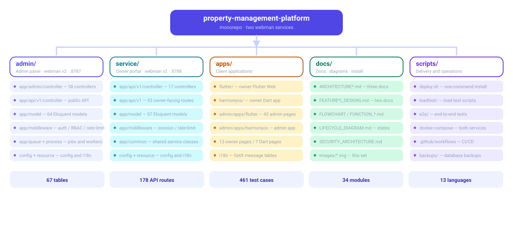
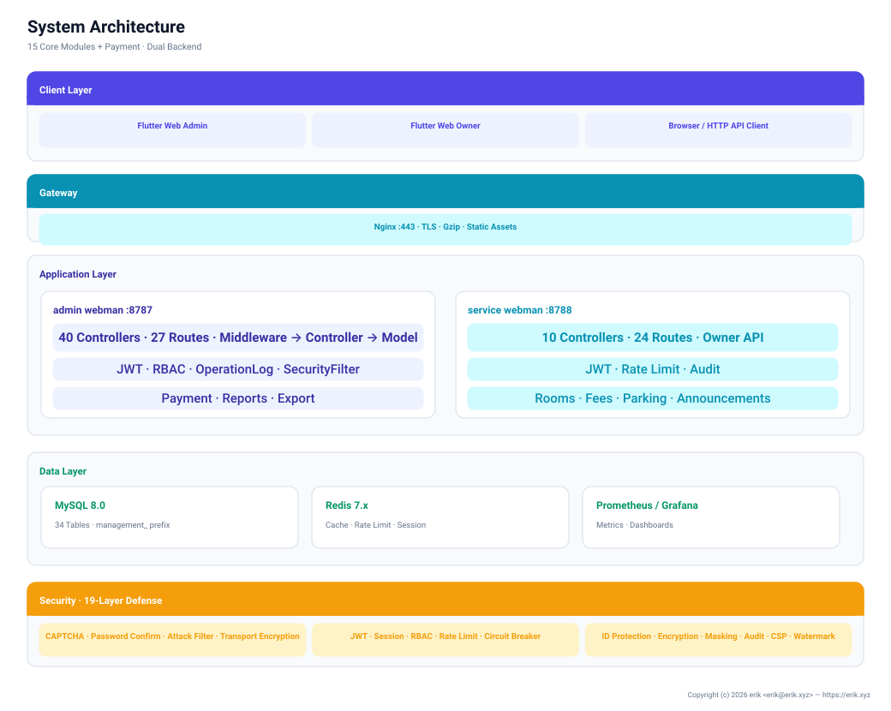
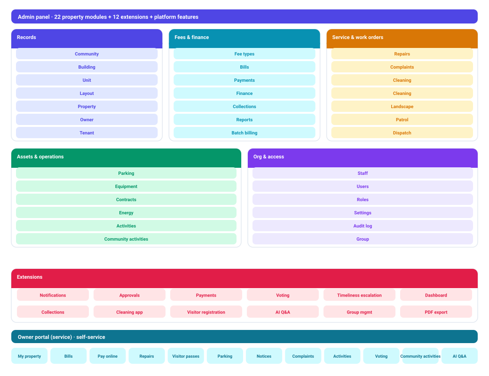
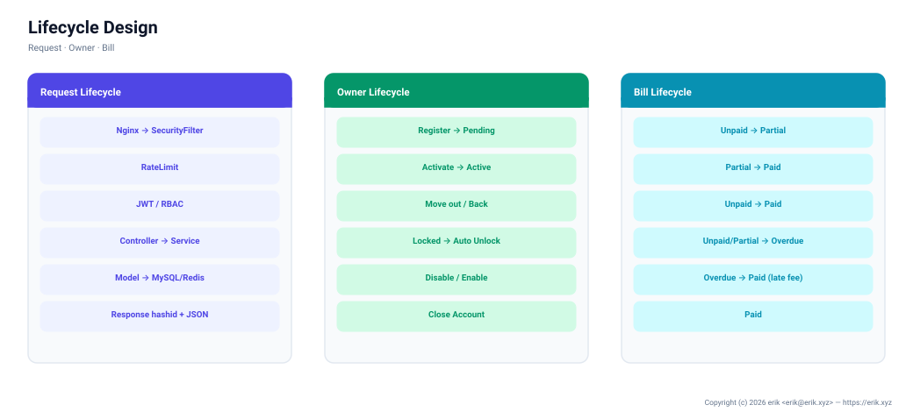

# Property Management Platform

[中文](README.md) | English

> Copyright (c) 2026 erik erik@erik.xyz — https://erik.xyz


A full-stack property management system covering 15 business modules + the payment integration extension. The admin panel and owner service are independently deployed, with a Flutter Web PC-style dashboard.

**Xiaozhu** (小筑) is the project mascot — a building steward: an apartment block with its lights on, wearing a steward's cap and carrying a work-order clipboard. It appears in the install wizard, error pages, the login page and the architecture diagram, standing for "every building under management has someone looking after it".

## Project Mascot · Xiaozhu


| Item | Description |
|------|-------------|
| Concept | An anthropomorphic building steward — lit windows are the units under management, the clipboard is the work-order loop |
| Palette | Indigo `#4F46E5` + amber `#F59E0B`, matching the front-end theme |
| Vector file | [docs/images/pet_xiaozhu.svg](docs/images/pet_xiaozhu.svg) (shared by Chinese and English) |
| Icon mark | [docs/images/favicon.svg](docs/images/favicon.svg), deployed to 6 locations (both Flutter apps' `assets/` and `web/`, `admin/public/`, `service/public/`); all platform bitmaps (app icons / splash / favicon.ico) generated by [scripts/gen-pet-icons.sh](scripts/gen-pet-icons.sh) |
| Wired into | 3-step install wizard + installed page · 404 / 504 error pages (inlined vector) · owner-side and admin-side Flutter login pages · shell icons and splash screens of both Flutter apps (launcher / app icon / splash) · Flutter empty-state illustrations · browser tab icon of both web entry points · multi-size favicon.ico on both backends · architecture cross-cutting rail |

## Project Structure

```
property-management-platform/
├── admin/                         # Admin panel — webman v2 project
│   ├── app/
│   │   ├── admin/controller/      # Admin controllers
│   │   ├── api/v1/controller/     # Public API controllers
│   │   ├── common/                # Shared utilities
│   │   ├── middleware/            # Middleware (auth/authz/rate-limit/security)
│   │   ├── model/                 # Data models (Eloquent ORM)
│   │   ├── queue/                 # Queue jobs
│   │   └── process/               # Process management
│   ├── apps/
│   │   └── flutter/               # Admin Flutter Web (PC dashboard style)
│   ├── config/                    # Config files (with Chinese annotations)
│   ├── database/
│   │   └── backup/                # Database backup scripts
│   ├── resource/
│   │   └── translations/          # i18n language files (zh_CN / en)
│   ├── docs/                      # Admin documentation
│   ├── tests/                     # Unit tests
│   └── public/                    # Web entry point
├── service/                       # Owner-facing API — webman v2 project
│   ├── app/
│   │   ├── api/v1/controller/     # Owner API controllers
│   │   ├── common/                # Shared utilities
│   │   ├── middleware/            # Middleware
│   │   ├── model/                 # Data models
│   │   └── process/               # Process management
│   ├── config/                    # Config files
│   ├── resource/
│   │   └── translations/          # i18n language files
├── apps/
│   └── flutter/                   # Owner portal Flutter Web (PC style)
└── docs/                          # Project documentation
    ├── ARCHITECTURE.md
    ├── ARCHITECTURE_DESIGN.md
    ├── ARCHITECTURE_DIAGRAM.md    # System architecture diagram
    ├── FLOWCHART.md               # Business flowchart
    ├── FUNCTION_DIAGRAM.md        # Function module diagram
    ├── LIFECYCLE_DIAGRAM.md       # Lifecycle diagram
    ├── SECURITY_ARCHITECTURE.md   # Security architecture diagram
    ├── API.md
    ├── FEATURES.md
    └── FEATURE_DESIGN.md
```



## Project Scale

| Layer | Count | Details |
|-------|-------|---------|
| Database Tables | 34 | All `management_` prefix, BIGINT non-auto-increment PK |
| PHP Models | 32 admin / 25 service | With encryptable field encryption |
| Admin Controllers | 40 | General admin + 15 modules + 1 extension |
| Service Controllers | 10 | Complete owner-facing API |
| API Routes | 51 | admin 27 + service 24 |
| Flutter Admin | 26 pages | 26 page modules, 67 files/5,520 lines |
| Flutter Owner | 5 pages | Bills/Parking, 18 files/2,099 lines |
| Tests | 11 | Flutter admin 1 + owner 10; backend test sources are not shipped with this tree, historical snapshots in [test reports](docs/tests/) |

## System Architecture & Design Diagrams

> The four diagrams below are hand-drawn SVG (English edition, `*_en.svg`; Chinese: `design_*.svg`). For finer Mermaid charts see [Architecture](docs/ARCHITECTURE_DIAGRAM.md) · [Flowchart](docs/FLOWCHART.md) · [Functions](docs/FUNCTION_DIAGRAM.md) · [Lifecycle](docs/LIFECYCLE_DIAGRAM.md) · [Security](docs/SECURITY_ARCHITECTURE.md)

### Architecture Design



### Function Design



### Lifecycles



### Core Business Flow



### 19-Layer Defense-in-Depth Security



## Feature Modules (15 Modules)

| Batch | Modules | Status |
|-------|---------|--------|
| Batch 1 | Community, Building, Unit, RoomType, Room, Owner, Tenant, Fee, Announcement (9) | ✅ Complete |
| Batch 2 | Parking, Equipment (2) + Dashboard/Export (platform features) | ✅ Complete |
| Batch 3 | Patrol, Cleaning, Green, Staff (4) | ✅ Complete |
| Extensions | Payment (1) | ✅ Complete |
| Platform | Report Center (collection rate, payment methods, arrears ranking, PDF export) + Owner home page stats (rooms / pending fees / announcements) | ✅ Complete |

## Tech Stack

### Backend
- **Framework**: webman v2 (workerman/webman)
- **Language**: PHP 8.3+
- **Database**: MySQL 8.0+, table prefix `management_`, BIGINT non-auto-increment PKs
- **Cache**: Redis 7.x

### Core Dependencies

| Package | Purpose |
|---------|---------|
| `erikwang2013/snowflake-php` | Globally unique BIGINT primary key generation |
| `erikwang2013/hashids` | API-layer ID encryption/decryption |
| `erikwang2013/jwt-webman` | JWT authentication (HS256) |
| `erikwang2013/encryption` | API transport AES-256-CBC encryption |
| `erikwang2013/encryptable` | Database field encryption |
| `illuminate/database` | Eloquent ORM / query builder / pagination |
| `erikwang2013/season` | Country flag data |
| `erikwang2013/security-php` | Security scanning |
| `erikwang2013/poster-php` | Sensitive operation verification |
| `phpoffice/phpspreadsheet` | Excel export |
| `barryvdh/laravel-dompdf` | PDF export |
| `hg/apidoc` | API documentation auto-generation |

### Frontend
- **Flutter 3.x** + GetX (with i18n) + Dio + fl_chart + flutter_svg (mascot vector art) — PC-style web dashboard for admin and owner portal

### API Documentation

Start the services and access the auto-generated apidoc:

| Side | URL | Groups |
|------|-----|--------|
| Admin | `http://localhost:8787/apidoc` | 10 groups (common/dashboard/system/property-core/property-aux/property-adv/extensions/export/import/upload) |
| Service | `http://localhost:8788/apidoc` | 6 groups (Public/Home/Fee/Feedback/Parking/Profile) |

### Internationalization (i18n)
- **PHP Backend**: symfony/translation, language files in `resource/translations/{zh_CN,en}/messages.php`
- **Flutter Web**: GetX `Translations`, `lib/i18n/messages.dart`
- **Default**: Simplified Chinese (zh_CN), fallback to English (en)

## Security (19-Layer Defense-in-Depth)

1. Click Captcha → 2. Password Confirmation → 3. Random Verification → 4. Security Scan → 5. Attack Interception (XSS/SQLi/CSRF) → 6. HTTPS + AES-256-CBC → 7. JWT HS256 → 8. Concurrent Session Limit (max 3) → 9. Account Lockout (5 failures/15 min) → 10. RBAC (method.path granularity) → 11. Redis Sliding Window Rate Limit → 12. Redis Circuit Breaker (payment/webhook fast-fail + half-open probe) → 13. Hashids ID Protection → 14. Request Body Encryption → 15. DB Field Encryption → 16. Display Masking → 17. Full Audit Trail (8 platform sources) → 18. CSP Headers → 19. PDF Copyright Watermark

## Coding Standards

- All new files include copyright header: `Copyright (c) 2026 erik erik@erik.xyz — https://erik.xyz`
- Use `use` imports instead of `\` prefix for global functions/classes
- Config files include Chinese annotations for each setting
- Primary keys: `BIGINT UNSIGNED NOT NULL`, generated by snowflake-php at the application layer
- API-layer ID transmission uses hashids encoding

## Quick Start

### Option 1: One-Click Install Script (Fastest)

```bash
bash scripts/deploy.sh
# Automatically: git pull → generate .env + keys for both apps → Docker Compose up
# → database init (idempotent) → monitoring smoke test
# Admin http://localhost:8787 · Service http://localhost:8788
```

> Requires Docker + Docker Compose. Idempotent and re-runnable; see [scripts/deploy.sh](scripts/deploy.sh).

### Option 2: Docker Compose Deployment

```bash
cd admin
cp .env.docker .env
php ../scripts/gen_env_keys.php --file=.env --replace-placeholders  # generate all secrets
docker compose up -d                                                # first boot imports the install SQL
# Service app: repeat in service/ (ports are pre-offset, coexists with admin on one host)
```

> Secrets are auto-generated: `change-me*` placeholders are replaced with random values; **existing keys are never overwritten** — re-runs only append missing keys. See [Docker Deployment](#docker-deployment) below for details.

### Option 3: Web Installer (Recommended)

Start the admin panel and open `http://localhost:8787/install` to configure the database and create an admin account through the UI.

```bash
cd admin
cp .env.example .env
composer install
php start.php start -d
# Visit http://localhost:8787/install to complete setup
```

See [Installation Guide](docs/INSTALL.md) for details.

### Option 4: Manual Setup

#### Requirements

- PHP 8.1+
- MySQL 8.0+
- Redis 6.0+
- Composer 2.x
- Flutter SDK 3.x (for frontend development)

#### 1. Initialize Database

```bash
# Create database
mysql -u root -e "CREATE DATABASE IF NOT EXISTS management DEFAULT CHARSET utf8mb4 COLLATE utf8mb4_unicode_ci;"

# Import merged install script (all 34 tables + RBAC seed data)
mysql -u root management < docs/install.sql
```

#### 2. Start Admin Panel

```bash
cd admin
cp .env.example .env
# Edit .env to configure database credentials
composer install
php start.php start -d
# Admin API runs at http://localhost:8787
```

### 3. Start Owner Service

```bash
cd service
cp .env.example .env
# Edit .env to configure database credentials
composer install
php start.php start -d
# Service API runs at http://localhost:8788
```

### 4. Start Frontend (Dev)

```bash
cd apps/flutter
flutter pub get
flutter run -d chrome
```

### 5. Run Tests

```bash
# Admin tests
cd admin && php vendor/bin/phpunit

# Service tests
cd service && php vendor/bin/phpunit
```

| Project | Tests | Assertions | Pass Rate |
|---------|-------|------------|-----------|
| admin | 260 | 622 | 100% (2 DB-gated skips) |
| service | 201 | 744 | 100% (8 DB-gated skips) |
| **Total** | **461** | **1366** | — |

Service test coverage: all 19 API controllers, 6 middleware, models/common services, security & feature regression
Full unit/API/E2E test reports: [docs/tests/](docs/tests/) (admin-unit-report / service-unit-report / api-report / e2e-report / go-unit-report / rust-unit-report)

### Docker Deployment

Each stack (admin / service) orchestrates independently: Nginx + PHP (webman) + MySQL + Redis + Prometheus + Grafana + redis-exporter.

```bash
# One command (recommended, idempotent): fill secrets → start both stacks → verify DB → monitoring smoke test
bash scripts/deploy.sh

# Manual, single stack (admin shown)
cd admin
cp .env.docker .env
php ../scripts/gen_env_keys.php --file=.env --replace-placeholders
docker compose up -d
```

**Secret semantics**

- `change-me*` values in the template are placeholders; `gen_env_keys.php` replaces them with random values. Real keys already present in `.env` are never overwritten (old keys preserved); missing keys are only appended
- Rotate the DB encryption key with `bash scripts/rotate_keys.sh` (the old key lands in `ENCRYPTION_PREVIOUS_KEYS`)
- The MySQL container's database/user/password derive from `DB_DATABASE/DB_USERNAME/DB_PASSWORD` (single source of truth) — no need to duplicate `MYSQL_*`

**Service ports** (pre-offset for a two-stack host; Nginx must be offset manually)

| Service | admin | service |
|---------|-------|---------|
| App | 8787 | 8788 |
| MySQL | 3306 | 3307 |
| Redis | 6379 | 6380 |
| Prometheus / Grafana | 9090 / 3000 | 9091 / 3001 |
| Nginx | 80 / 443 | 8080 / 8443 recommended (`NGINX_PORT`/`NGINX_SSL_PORT`) |

> On first boot the MySQL volume is empty and `docs/install.sql` (34 tables + RBAC seed) is imported automatically via the compose initdb mount; existing volumes are left untouched.
>
> ⚠️ After a Docker deployment do not use the Web Installer (`/install`) to change DB settings — it rewrites `DB_*` in `.env` and breaks the container's `DB_HOST=mysql` connection.

## Deployment Topology

```
Nginx (:443) → admin webman (:8787) + service webman (:8788) → MySQL + Redis
Static files: Flutter Web build/
```

## Usage Guide

### Admin Panel

1. Open `http://localhost:8787` in a browser and sign in with the default admin account (see below).
2. **Set up base data**: enter Community → Building → Unit → Room Type → Room, then bind owners under Owner Management.
3. **Daily operations**:
   - Fees: configure fee types → batch-generate bills → owners pay online/offline;
   - Report Center: view collection rate, payment methods and arrears ranking by date range, export to PDF.
4. **System**: User Management (admins), Roles & Permissions (RBAC), System Config (key-values), Audit Logs.

### Owner Portal (service)

1. Open `http://localhost:8788` (or Flutter Web), register or sign in.
2. Home page stats: my rooms, pending fees, latest announcements.
3. Common actions: pay fees, parking lookup.

### Frontend

- **Flutter Web**: `cd apps/flutter && flutter run -d chrome` (owner portal)

## Default Admin Account

| Username | Password | Role |
|----------|----------|------|
| admin | Admin@123456 | Super Admin |

> This account is created automatically by the one-click deploy (`bash scripts/deploy.sh`); if you install via the web wizard, set your own in step 2.
>
> Change the default password immediately in production (rule: 8–32 chars with upper/lower-case letters, digits and special characters `@$!%*?&`).

## Document Index

| Document | Description |
|----------|-------------|
| [Installation Guide](docs/INSTALL.md) | Deployment guide: database init, Docker, FAQ |
| [Install SQL](docs/install.sql) | All 34 tables + RBAC seed data, single import |
| [Architecture Design](docs/ARCHITECTURE_DESIGN.md) | Layered architecture, middleware chain, security defense-in-depth |
| [Architecture Diagrams](docs/ARCHITECTURE.md) | Mermaid diagrams (topology, request lifecycle, data encryption, deployment) |
| [Architecture Diagram](docs/ARCHITECTURE_DIAGRAM.md) | System architecture, layered detail, deployment (Mermaid visualization) |
| [Business Flowchart](docs/FLOWCHART.md) | Auth flow, fee management, property |
| [Function Diagram](docs/FUNCTION_DIAGRAM.md) | 16 modules overview, dependencies, admin feature tree, owner portal map |
| [Lifecycle Diagram](docs/LIFECYCLE_DIAGRAM.md) | Request lifecycle, entity lifecycle, token lifecycle, CRUD flow |
| [Security Architecture](docs/SECURITY_ARCHITECTURE.md) | 18-layer defense-in-depth, attack surface matrix, encryption chain, audit system |
| [Feature Design](docs/FEATURE_DESIGN.md) | 16 module feature specifications |
| [Features](docs/FEATURES.md) | Feature checklist and module overview |
| [API Reference](docs/API.md) | Complete API endpoints and parameters |

## Support

Thank you for your support!

|  |  |
|:---:|:---:|
| WeChat Pay | Alipay |

## Open Source vs Commercial Edition

The open-source edition includes 15 core business modules and 1 extension module (payment integration) for personal study, research, and secondary development. The commercial edition adds 7 core business modules, 11 extension modules, three additional frontends, and an Elasticsearch search stack on top of the same core. Code comparison found no open-source-only business modules: the open-source edition is a subset of the commercial edition.

| Dimension | Open Source | Commercial |
|---|---|---|
| Feature coverage | 15 core + 1 extension; 50 controllers / 57 models / 51 routes / 34 tables | 22 core + 12 extensions; 81 controllers / 123 models / 191 routes / 67 tables; adds repairs, complaints, visitors, contracts, finance, activities, energy, notifications, approval, voting, collection, group, knowledge, inspection, SLA, mall, face, dashboard |
| Security | JWT + RBAC, SecurityFilter, RateLimit, OperationLog, PasswordRule, security-php, gitleaks/phpstan; 19-layer defense | Same backend security stack (identical 16 middleware, PasswordRule and security plugin); adds Angular/React/HarmonyOS frontends and ES, so a larger attack surface with the same controls |
| Performance and scale | webman, Redis cache/queue; 12 compose services; MySQL LIKE search | Same stack + Elasticsearch; 15 compose services; more Redis usage (30 vs 26 files), suited to larger data volumes |
| Data and search | 34 tables; MySQL LIKE | 67 tables; Elasticsearch + webman-scout |
| Tests and quality | Backend test sources are not shipped (CI skips when `tests/` is empty); 11 Flutter tests; CI runs php-syntax/flutter/phpstan/secrets/monitoring | Commercial edition has a different test claim; CI additionally runs react-build/angular-build; backend test sources are delivered separately |
| Deployment and operations | Docker Compose 12 services, installer, health/metrics, Prometheus, backup scripts | 15 compose services (+ES/monitoring); same installer, health checks, monitoring and backups, with a larger deployment surface |
| Clients and i18n | Flutter admin 67 Dart + owner app 18 Dart; zh_CN/en resources | Flutter 99 + Angular 60 + React 42 + HarmonyOS 12; owner Flutter 33 + HarmonyOS 14; still zh_CN/en resources |
| Extensibility | 15+1 modules, RBAC, `/apidoc`, config-driven | 22+12 modules, more permission seeds (about 248 vs 134), three optional web admin frontends, but a larger maintenance surface |
| Licensing and support | Personal study/research; commercial use requires written authorization | Commercial licensing, delivery and support; contact erik@erik.xyz |
| Use cases | Personal study, research, secondary development, small self-hosted deployments | Commercial deployment, production operations, multi-client and large-data scenarios |

Commercial-only modules (confirmed by code comparison):

- **Repairs**: repair orders/progress with dispatch and rating, 2 tables.
- **Complaints**: intake, follow-up and satisfaction, 1 table.
- **Visitors**: visitor appointments, approval and pass codes, 1 table.
- **Contracts**: property/lease/maintenance/service/procurement contracts, 1 table.
- **Finance**: income/expense records and statistics, 2 tables.
- **Community activities**: activities with signup and check-in, 2 tables.
- **Energy**: energy meters and meter readings, 2 tables.
- **Notifications**: notification templates and message center, 2 tables.
- **Approval workflow**: approval types/instances/records, 3 tables.
- **Owner voting**: votes/options/records with area-weighted tally, 3 tables.
- **Smart collection**: collection strategies/records and late fees, 2 tables.
- **Group management**: groups/community links and cross-community summary, 2 tables.
- **Knowledge Q&A**: knowledge base/chat records, 2 tables.
- **Mobile inspection**: inspection tasks/checkpoints and pages, 2 tables.
- **SLA auto-escalation**: SLA rules/records and admin pages, 2 tables.
- **Community mall**: products/categories/orders and owner mall pages, 3 tables.
- **Face capture and manual review**: upload, approve, reject, 1 table (marketed as "face recognition").
- **Data dashboard**: listed as an extension in the commercial README; no dedicated big-screen controller/page was found in code — it is dashboard visualization.

The open-source edition retains 15 core modules, the payment integration extension, the Flutter admin and owner apps, and the 19-layer security architecture.

> For commercial licensing and delivery terms, contact **erik@erik.xyz**.

## 项目授权 / Project License

Copyright (c) 2026 erik erik@erik.xyz — https://erik.xyz

- 本项目仅供个人学习、研究使用。
- 未经作者书面授权，禁止任何形式的商业使用（包括但不限于商业部署、付费服务、二次销售、SaaS 运营及以本项目为基础提供商业服务）。
- 商业授权请联系 **erik@erik.xyz**。
- 未经授权的商业使用，作者将在全球范围内依法追究法律责任，并保留终身追责的权利。
- 第三方组件仍遵循其各自原有的许可证；视觉资产适用仓库内的 ASSETS-LICENSE.md（如适用）。

**English:** This project is provided for personal study and research only. Commercial use of any kind requires prior written authorization from the author (erik@erik.xyz). Unauthorized commercial use will be pursued for legal liability worldwide, and the author reserves the right to pursue such liability for life. Third-party components remain under their original licenses; visual assets are governed by ASSETS-LICENSE.md where applicable.
