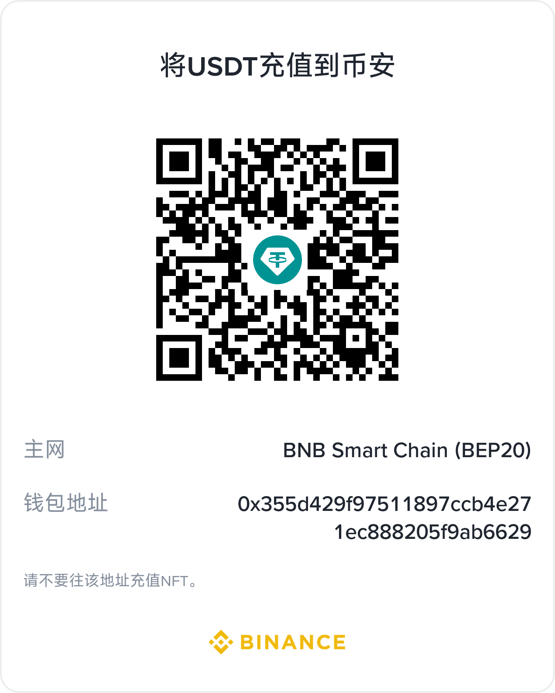

# Property Management Platform

[English](../en/README.md) | [中文](../../../README.md)

> Copyright (c) 2026 erik erik@erik.xyz — https://erik.xyz


A full-stack property management system covering 15 business modules + the payment integration extension. The admin panel (admin) and owner portal (service) are deployed separately, with frontends built with Flutter Web (PC admin style) and Flutter mobile.

**Xiaozhu** (小筑) is the project mascot — an anthropomorphic building steward with its lights on, appearing in the install wizard, the error pages, the login page and the architecture diagram.

## Project Structure

```
property-management-platform/
├── admin/ # Admin webman v2 project
│ ├── app/
│ │ ├── admin/controller/ # Admin controllers
│ │ ├── api/v1/controller/ # Public API controllers
│ │ ├── common/ # Shared utility classes
│ │ ├── middleware/ # Middleware (auth / authorization / rate limiting / security)
│ │ ├── model/ # Data models (Eloquent ORM)
│ │ ├── queue/ # Queue tasks
│ │ └── process/ # Process management
│ ├── apps/
│ │ ├── flutter/ # Admin Flutter Web (PC style)
│ ├── config/ # Configuration files (with Chinese comments)
│ ├── database/
│ │ └── backup/ # Database backup scripts
│ ├── resource/
│ │ └── translations/ # i18n language files (zh_CN / en)
│ ├── docs/ # Admin documentation
│ ├── tests/ # Unit tests
│ └── public/ # Web entry
├── service/ # Owner business webman v2 project
│ ├── app/
│ │ ├── api/v1/controller/ # Owner API controllers
│ │ ├── common/ # Shared utility classes
│ │ ├── middleware/ # Middleware
│ │ ├── model/ # Data models
│ │ └── process/ # Process management
│ ├── config/ # Configuration files
│ ├── resource/
│ │ └── translations/ # i18n language files
├── apps/
│ ├── flutter/ # Owner Flutter Web (PC style)
└── docs/ # Project documentation
 ├── ARCHITECTURE.md
 ├── ARCHITECTURE_DESIGN.md
 ├── ARCHITECTURE_DIAGRAM.md # System architecture diagrams
 ├── FLOWCHART.md # Business flowcharts
 ├── FUNCTION_DIAGRAM.md # Function module diagrams
 ├── LIFECYCLE_DIAGRAM.md # Lifecycle diagrams
 ├── SECURITY_ARCHITECTURE.md # Security architecture diagrams
 ├── API.md
 ├── FEATURES.md
 └── FEATURE_DESIGN.md
```


## Project Scale

| Layer | Count | Details |
|----|------|------|
| Database tables | 34 | All `management_` prefixed, BIGINT non-auto-increment primary keys |
| PHP models | admin 32 / service 25 | All Eloquent models with encryptable encrypted fields; service 25 is the model file count (including the BaseModel base class) |
| admin controllers | 40 | General management + 15 property modules + 1 extension feature |
| service controllers | 10 | All owner-side APIs |
| API routes | 51 | admin 27 + service 24 |
| Flutter admin panel | 26 pages | admin 26 page modules, 67 files / 5,532 lines |
| Flutter owner portal | 5 pages | charges / parking, 17 files / 1,942 lines |
| Tests | 76 | Backend 65 (admin 43/103 assertions + service 22/42) + Flutter 11 (admin 1 + owner 10); shipped with the source |

## System Architecture & Design Diagrams

> The following are overview diagrams; see [Architecture Diagram](docs/ARCHITECTURE_DIAGRAM.md) · [Flowchart](docs/FLOWCHART.md) · [Function Diagram](docs/FUNCTION_DIAGRAM.md) · [Lifecycle Diagram](docs/LIFECYCLE_DIAGRAM.md) · [Security Architecture Diagram](docs/SECURITY_ARCHITECTURE.md) for detailed charts

### System Overview Architecture


### Function Module Overview


### Data Entity Lifecycle


### Core Business Flow


### 19-Layer Security Defense in Depth


## Function Modules (15 Major Modules + 1 Extension)

| Batch | Modules | Status |
|------|------|------|
| Batch 1 | Community, building, unit, layout, property, owner, tenant, charges, announcements (9 modules) | ✅ All complete |
| Batch 2 | Parking, equipment (2 modules) + panel visualization + Excel/PDF export (platform features) | ✅ All complete |
| Batch 3 | Security patrol, cleaning, greening, staff (4 modules) | ✅ All complete |
| Extensions | Payment integration (1 module) | ✅ All complete |
| Platform | Report Center (collection rate, payment methods, arrears ranking, PDF export) + Owner home stats (rooms / pending fees / announcements) | ✅ All complete |

## Tech Stack

### Backend
- **Framework**: webman v2 (workerman/webman)
- **Language**: PHP 8.3+
- **Database**: MySQL 8.0+, table prefix `management_`, BIGINT non-auto-increment primary keys
- **Cache**: Redis 7.x

### Core Dependencies
| Package | Purpose |
|------|------|
| `erikwang2013/snowflake-php` | Globally unique BIGINT primary key generation |
| `erikwang2013/hashids` | API-layer ID encryption/decryption |
| `erikwang2013/jwt-webman` | JWT authentication (HS256) |
| `erikwang2013/encryption` | AES-256-CBC encryption of sensitive data in API transport |
| `erikwang2013/encryptable` | Encryption/decryption of sensitive database fields |
| `illuminate/database` | Eloquent ORM / query builder / pagination |
| `erikwang2013/season` | Country flag data |
| `erikwang2013/security-php` | Security tool detection |
| `erikwang2013/poster-php` | Random verification codes for sensitive operations |
| `phpoffice/phpspreadsheet` | Excel export |
| `barryvdh/laravel-dompdf` | PDF export |
| `hg/apidoc` | Automatic API documentation generation |

### Frontend
- **Flutter 3.x** + GetX (with i18n) + Dio + fl_chart — PC-style Web admin panel
- **Flutter mobile** — cross-platform mobile app

### API Documentation

All API endpoints and parameter descriptions are in the standalone [docs/API.md](docs/API.md). After starting the services, you can also access the interactive documentation auto-generated by apidoc:

| End | Address | Groups |
|----|------|------|
| Admin | `http://localhost:8787/apidoc` | 10 groups (common/dashboard/system/property-core/property-aux/property-adv/extensions/export/import/upload) |
| Owner | `http://localhost:8788/apidoc` | 6 groups (public/home/charges/feedback/parking/profile) |

### Internationalization

- **PHP Backend**: symfony/translation, language files in `resource/translations/{zh_CN,en}/messages.php`
- **Flutter Web**: GetX `Translations`, `apps/flutter/lib/i18n/messages.dart`
- **Default Language**: Simplified Chinese (zh_CN), switchable to English (en)
- **Request Header**: response language controllable via `Accept-Language` request header

## Security System (19-Layer Defense in Depth)

1. Click captcha → 2. Password re-confirmation → 3. poster random verification → 4. security-php security scan → 5. SecurityFilter attack blocking → 6. HTTPS + AES-256-CBC transport encryption → 7. JWT HS256 authentication → 8. Concurrent session limit (max 3) → 9. Account lockout (5 failures/15 minutes) → 10. RBAC permission authorization (method.path granularity) → 11. Redis sliding window rate limiting → 12. Redis Circuit Breaker (payment/webhook fast-fail + half-open probe) → 13. Hashids ID protection → 14. Request body sensitive field encryption → 15. DB field encrypted storage → 16. Display-layer data masking → 17. Full operation log audit (8 platform sources) → 18. CSP header protection → 19. PDF copyright watermark

## Coding Standards

- All new files begin with the copyright notice: `Copyright (c) 2026 erik <erik@erik.xyz> — https://erik.xyz`
- Global functions/classes are imported with `use`, without a leading `\`
- Configuration files contain Chinese comments explaining each config item
- Primary key IDs use BIGINT UNSIGNED NOT NULL, generated at the application layer by snowflake-php
- API-transmitted IDs use hashids encryption/decryption

## Quick Start
### ⚡ One-Click Install Script (Fastest)

```bash
bash scripts/deploy.sh
# Automatically: git pull → generate .env + keys → mysql/redis → schema migration → app → phone_hash backfill → nginx → DB init (idempotent) → monitoring smoke test
# Admin http://localhost:8787 · Service http://localhost:8788
```

> Requires Docker + Docker Compose. Idempotent and re-runnable; see [scripts/deploy.sh](../../../scripts/deploy.sh).


### Option 1: Web Installation Wizard (Recommended)

After starting the admin service, visit `http://localhost:8787/install` to complete database configuration and create the admin account through the UI.

```bash
cd admin
cp .env.example .env
composer install
php start.php start -d
# Visit http://localhost:8787/install to complete the installation
```

See the [Installation Guide](docs/INSTALL.md) for details.

### Option 2: Manual Installation

#### Environment Requirements

- PHP 8.1+
- MySQL 8.0+
- Redis 6.0+
- Composer 2.x
- Flutter SDK 3.x (frontend development)

#### 1. Initialize the Database

```bash
mysql -u root -e "CREATE DATABASE IF NOT EXISTS management DEFAULT CHARSET utf8mb4 COLLATE utf8mb4_unicode_ci;"
mysql -u root management < docs/install.sql
```

#### 2. Start the Admin Service

```bash
cd admin
cp .env.example .env
# Edit .env to change database password and other config
composer install
php start.php start -d
# Admin service runs at http://localhost:8787
```

### 3. Start the Business Service

```bash
cd service
cp .env.example .env
# Edit .env to change database password and other config
composer install
php start.php start -d
# Business service runs at http://localhost:8788
```

### 4. Start the Frontend (Development)

```bash
cd apps/flutter
flutter pub get
flutter run -d chrome
```

### 5. Run Tests

```bash
# Admin tests
cd admin && php vendor/bin/phpunit

# Business service tests
cd service && php vendor/bin/phpunit
```

| Project | Tests | Assertions | Pass Rate |
|------|--------|--------|--------|
| admin | 43 | 103 | 100% |
| service | 22 | 42 | 100% |
| **Total** | **65** | **145** | — |

Backend tests cover payment pure functions / WeChat callback decryption / bill status and late fees / password rules / Validator / pagination; Flutter has 11 tests (admin 1 + owner 10). CI runs PHPUnit with coverage floors of 1.7% (admin) and 3% (service); both stacks pass PHPStan. Historical full-suite snapshots live in [docs/tests/](docs/tests/).

### Docker Deployment

```bash
cd admin
cp .env.docker .env
docker compose up -d
# 7 services per stack: Nginx + PHP + MySQL + Redis + Prometheus + Grafana + redis-exporter
```

**Upgrading an existing database**: run `docs/migrations/2026-10-30-audit-fix-schema.sql`, then `scripts/backfill_owner_phone_hash.php`. `scripts/deploy.sh` does both automatically in the order mysql/redis → schema migration → app → backfill → nginx. Fresh installs use `docs/install.sql`. Deduplicate any non-NULL duplicate `(room_id, fee_type_id, start_date)` fee-period rows first, or the unique index is skipped.

## Deployment Topology

```
Nginx (:443) → admin webman (:8787) + service webman (:8788) → MySQL + Redis
Static files: Flutter Web build/
```

## Usage Guide

### Admin Panel
1. Open `http://localhost:8787` and sign in with the default admin account.
2. Set up base data: Community → Building → Unit → Room Type → Room → bind owners.
3. Daily operations: configure fee types, batch-generate bills, collect via an admin-created payment order or offline; Report Center for collection overview.
4. System: add admins, RBAC roles, config, audit logs.

### Owner Portal
Open `http://localhost:8788` (or Flutter Web): the home page shows rooms, pending fees, and announcements. Online payment from the owner app is not connected to a gateway (`POST /service/v1/fees/pay` always returns 503); pay via an admin-created payment order or offline.

## Default Admin Account

| Username | Password | Role |
|--------|------|------|
| admin | Admin@123456 | Super admin |

> This account is created automatically by the one-click deploy (`bash scripts/deploy.sh`); override the password via `ADMIN_INITIAL_PASSWORD` in `.env`, or set your own in step 2 of the web wizard.

> Change the default password immediately in production.

## Documentation Index

| Document | Description |
|------|------|
| [Installation Guide](docs/INSTALL.md) | Step-by-step deployment guide, including database initialization, Docker deployment, and FAQ |
| [Merged Installation Script](../../install.sql) | All 34 tables + RBAC permission seed data, one-click import |
| [Architecture Design Document](docs/ARCHITECTURE_DESIGN.md) | System layered architecture, middleware execution chain, security defense-in-depth design |
| [Architecture Document](docs/ARCHITECTURE.md) | Mermaid architecture diagrams (system topology, request lifecycle, data encryption, deployment) |
| [System Architecture Diagram](docs/ARCHITECTURE_DIAGRAM.md) | Overview architecture, layered details, deployment architecture (Mermaid visualization) |
| [Business Flowchart](docs/FLOWCHART.md) | Authentication flow, charge management, property management |
| [Function Module Diagram](docs/FUNCTION_DIAGRAM.md) | 16-module overview, dependencies, admin function tree, owner function map |
| [Lifecycle Diagram](docs/LIFECYCLE_DIAGRAM.md) | Request lifecycle, entity lifecycle, Token lifecycle, full CRUD flow |
| [Security Architecture Diagram](docs/SECURITY_ARCHITECTURE.md) | 19-layer defense-in-depth overview, attack surface defense matrix, full encryption chain, audit trail system |
| [Feature Design Document](docs/FEATURE_DESIGN.md) | Functional specifications for the 16 modules |
| [Features Document](docs/FEATURES.md) | Feature list and module overview |
| [API Document](docs/API.md) | All API endpoints and parameter descriptions |

## Support the Project

Thank you for your support!

|  |  |
|:---:|:---:|
| WeChat Pay | Alipay |

### Global Bank Transfer Donations

Bank transfers from around the world are supported; the receiving account is ZA Bank (ZhongAn Bank) in Hong Kong:

| Item | Information |
|------|------|
| Beneficiary Name | WANG KEXUN |
| Beneficiary Account Number | 881015918251 |
| Receiving Bank | ZA Bank Limited |
| SWIFT Code | AABLHKHHXXX |
| Bank Code | 387 |
| Bank Address | Core F, Cyberport 3, 100 Cyberport Road, Hong Kong |

> **Cross-border remittance correspondent bank (intermediary bank)**: The following is the correspondent bank (intermediary bank) information, not the receiving bank information. Please check with your remitting bank whether correspondent bank information is required.
>
> - **For HKD, CNY and USD remittances** (Citibank N.A. Hong Kong): SWIFT `CITIHKXXXX`, bank code 006, branch code 391, address: Citibank Tower, Citibank Plaza, 3 Garden Road, Central, Hong Kong
> - **For other currencies** (THE BANK OF NEW YORK MELLON): SWIFT `IRVTUS3NXXX`, address: 240 GREENWICH STREET, NEW YORK, United States

### Crypto Donation

If this project helps you, scan the QR code to donate, thank you!

|  **BNB Smart Chain (BEP20)** `0x355d429f97511897ccb4e271ec888205f9ab6629` |  **Tron (TRC20)** `TEdDHWLajt1XvqtPDWmQctdrJaC3pzZZzz` |
|  **Ethereum (ERC20)** `0x355d429f97511897ccb4e271ec888205f9ab6629` |  **Aptos** `0x836e3780edfc3f7b2372b39e2a1a3a5d7adfaccd96c726f21cfde1b50dd68030` |
|  **Plasma** `0x355d429f97511897ccb4e271ec888205f9ab6629` |  **Polygon POS** `0x355d429f97511897ccb4e271ec888205f9ab6629` |
|  **Solana** `2hfhboHdmdrYsY25XfQSsEWxq5ip4EQsR7f4AzSRMUyr` |  **The Open Network (TON)** `UQB9kFQohzmXUir9QSSZq01iwl9aQZIDdBpNmDklljRtCoGK` |
|  **Arbitrum One** `0x355d429f97511897ccb4e271ec888205f9ab6629` |  **AVAX C-Chain** `0x355d429f97511897ccb4e271ec888205f9ab6629` |

Your support is welcome!

## License

MIT License. See [LICENSE](../../../LICENSE) for details.
